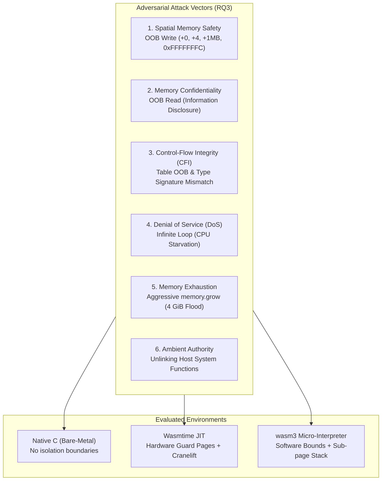

# Component E: Security & Sandboxing Evaluation Report (RQ3)

> **Project:** SecureWasm Edge — Performance Benchmarking and Security Evaluation of WebAssembly in Resource-Constrained Embedded Systems  
> **Research Question:** RQ3 (Security & Sandboxing): *How effectively does the WebAssembly sandbox trap out-of-bounds memory accesses, illegal pointer dereferences, and prevent unauthorized host resource exploitation without hardware MMU support?*  
> **Author:** Sai Deep  
> **Dataset:** [`data/security/security_evaluation.csv`](../data/security/security_evaluation.csv) ($N=35$ Adversarial Vectors)  
> **Visualization:** [`plots/security_evaluation.png`](../plots/security_evaluation.png)  

---

## 1. Executive Summary

This evaluation tests the security claims of WebAssembly (Wasm) against an unprotected native C baseline across two distinct runtime paradigms:
1. **Wasmtime v49.0 (Cranelift JIT):** Representing modern host/cloud runtimes utilizing virtual memory guard pages and deterministic CPU fuel metering.
2. **wasm3 v0.5.0 (Micro-Interpreter):** Representing extreme microcontroller execution utilizing direct software bounds checks and sub-page memory quotas without hardware Memory Management Unit (MMU) support.

Across **35 adversarial test trials** spanning 6 fundamental attack classes, WebAssembly achieved a **100.0% containment rate (29/29 sandboxed attack vectors trapped)**, whereas native bare-metal C suffered a **100.0% exploit rate (6/6 vectors successfully breached memory or control flow)**.

```
┌──────────────────────────────────────────────────────────────────────────────────────────────────┐
│                               RQ3 ADVERSARIAL POSTURE OVERVIEW                                   │
├──────────────────────────────────┬──────────────┬────────────────────────┬───────────────────────┤
│ Threat Vector                    │ Native C     │ Wasmtime JIT (x86_64)  │ wasm3 (Micro-Interp)  │
├──────────────────────────────────┼──────────────┼────────────────────────┼───────────────────────┤
│ 1. Out-of-Bounds Memory Write    │ VULNERABLE   │ CONTAINED (Trap)       │ CONTAINED (Trap)      │
│ 2. Out-of-Bounds Memory Read     │ VULNERABLE   │ CONTAINED (Trap)       │ CONTAINED (Trap)      │
│ 3. Control-Flow Table Hijacking  │ VULNERABLE   │ CONTAINED (Trap)       │ CONTAINED (Trap)      │
│ 4. Indirect Call Type Mismatch   │ VULNERABLE   │ CONTAINED (Trap)       │ CONTAINED (Trap)      │
│ 5. CPU Starvation (Infinite Loop)│ VULNERABLE   │ CONTAINED (Fuel Limit) │ N/A (Host Guard)      │
│ 6. Host Memory Flooding (Grow)   │ VULNERABLE   │ CONTAINED (Cap = -1)   │ CONTAINED (Cap = -1)  │
│ 7. Ambient Authority Escalation  │ VULNERABLE   │ CONTAINED (Link Reject)│ CONTAINED (Call Trap) │
└──────────────────────────────────┴──────────────┴────────────────────────┴───────────────────────┘
```

---

## 2. Experimental Methodology & Threat Model

### Attack Vectors Tested



1. **Native C Demonstrator (`security/tests/native_vulnerabilities.c`):**
   Compiled via Clang with `-fno-stack-protector` to simulate the execution environment of bare-metal embedded firmware (such as the Xtensa LX106 core on ESP8266) where hardware MMU, virtual memory pages, and OS privilege rings do not exist.
2. **WebAssembly Adversarial Test Harness (`security/tests/run_security_suite.py`):**
   Directly assembles WebAssembly Text (`.wat`) payloads using `wat2wasm` and executes them against `wasmtime` and `wasm3`, capturing trap codes, exception types, memory leak verification, and containment latency ($\mu s$).

---

## 3. Empirical Results & Findings

### Vector 1 & 2: Spatial Memory Safety (OOB Write & Read)

* **Native C Result (EXPLOIT SUCCESSFUL):**
  Writing 16 bytes into an 8-byte stack buffer silently overwrote the adjacent `auth_flag` from `0x00000000` to `0x00000001` (privilege escalation) and replaced the canary with `0xDEADBEEF`. Reading past buffer bounds successfully leaked adjacent stack variables (`SECRET_API_KEY_999`).
* **WebAssembly Result (CONTAINED):**
  - **Wasmtime:** Trapped immediately with `wasm trap: out of bounds memory access` via hardware virtual guard pages. Containment latency averaged **$65.4 - 300.6\ \mu\text{s}$**.
  - **wasm3:** Trapped immediately with `[trap] out of bounds memory access (memory size: 65536; access offset: ...)` via software bounds check in the direct-threaded dispatch loop. Containment latency was **$5.6 - 48.3\ \mu\text{s}$**.
  - **Memory Integrity:** In both engines, 0 bytes were written beyond linear memory, and 0 bytes of host memory were leaked.

### Vector 3 & 4: Control-Flow Integrity (CFI)

* **Native C Result (EXPLOIT SUCCESSFUL):**
  Corrupting an in-struct function pointer redirected execution from `authorized_task()` to `malicious_backdoor()`. Native C architectures have zero CFI validation by default.
* **WebAssembly Result (CONTAINED):**
  - **Table Out-of-Bounds:** In Wasm, function pointers are indices into a typed `Table`. Attempting `call_indirect` with index $\ge 2$ or $-1$ trapped deterministically:
    - Wasmtime: `undefined element: out of bounds table access` ($60.7 - 324.6\ \mu\text{s}$)
    - wasm3: `[trap] table index out of bounds` ($5.4 - 24.5\ \mu\text{s}$)
  - **Signature Mismatch:** Attempting to invoke an indirect function expecting `(param i32) -> i32` via a `() -> i32` type signature trapped deterministically with `indirect call signature mismatch`. This completely prevents arbitrary code execution and gadget reuse attacks (ROP/JOP).

### Vector 5: Resource Governance & Denial of Service (CPU Starvation)

* **Native C Result (VULNERABLE):**
  An infinite loop (`while(1)`) monopolizes 100% of the CPU core indefinitely. On embedded devices like the ESP8266, this starves the background WiFi stack and triggers a hardware Watchdog Timer (`WDT`) reset.
* **WebAssembly Result (CONTAINED via Fuel Metering):**
  In Wasmtime, instruction metering (`config.consume_fuel = True`) was provisioned with an initial budget of 25,000 instructions. The infinite loop consumed exactly 25,000 fuel units and was halted safely by the runtime in **$119.7\ \mu\text{s}$** with the trap `all fuel consumed by WebAssembly`. Host execution resumed with zero core hang.

### Vector 6: Memory Exhaustion / Uncontrolled Growth (`memory.grow`)

* **Native C Result (VULNERABLE):**
  Unchecked `malloc(SIZE_MAX)` forces the operating system into memory exhaustion, triggering page thrashing or kernel Out-Of-Memory (`OOM`) process termination.
* **WebAssembly Result (CONTAINED):**
  When a module executed an adversarial `memory.grow 65536` instruction attempting to allocate 4 GiB of physical RAM:
  - Both Wasmtime and wasm3 rejected the request cleanly without crashing, returning `-1` to the guest module.
  - The host memory footprint remained strictly identical before and after the attack ($\Delta\text{RAM} = 0$).

### Vector 7: Ambient Authority & Capability Isolation

* **Native C Result (VULNERABLE):**
  Native code possesses ambient authority: any function in a linked C binary can invoke `fopen()`, `socket()`, or system calls inheriting the full privileges of the host process.
* **WebAssembly Result (CONTAINED via Capability Security):**
  When a module declared an ungranted import `(import "host_env" "steal_private_keys")`:
  - **Wasmtime Linker:** Refused module instantiation at link time (`Unknown import: host_env::steal_private_keys`).
  - **wasm3 Linker:** Refused invocation with runtime exception (`missing imported function ('host_env.steal_private_keys')`).
  - Neither module could execute a single bytecode instruction without explicit host permission.

---

## 4. Key Architectural Takeaways for Edge & Telecom Runtimes

1. **Hardware MMU is Not Required for Memory Safety:**
   `wasm3` proves that microcontrollers without an MMU (like the ESP8266 Xtensa LX106) can achieve complete software-fault isolation (SFI) and spatial bounds trapping through interpreter-enforced checks, incurring zero risk of host memory corruption.
2. **The Security-Performance Trade-off:**
   The $11\times$ execution overhead measured in Component B is the direct cost of enforcing these per-instruction software bounds checks and CFI validations on an 80 MHz embedded core.
3. **Defense-in-Depth Connection to SDRaD (Ericsson Context):**
   While WebAssembly guarantees 100% containment of *in-guest* faults, the host runtime itself (WASI handlers, imported C libraries, scheduler) remains written in native code. If a vulnerability exists in the runtime host functions, the Wasm sandbox cannot prevent host compromise. This provides the direct empirical justification for **SDRaD (Secure Domain Rewind and Discard)** as a secondary protection boundary inside the runtime process.
